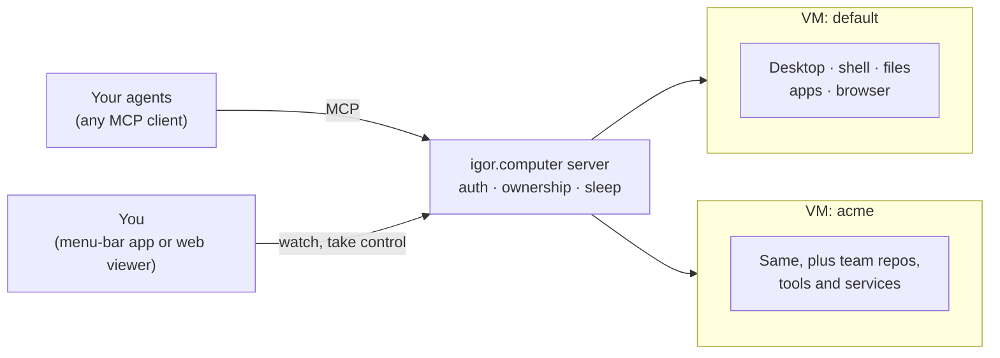

# igor.computer

**A real computer for your AI agents, running on your own machine.**

- **A full Linux desktop.** A shell, files, apps and a real browser.
- **It remembers.** Files, tools, running services and logins are still there next time.
- **You can step in.** When the agent needs a login, a CAPTCHA or a decision, it asks you. You take the mouse, sort it out and hand it back.
- **Any agent.** It works with anything that speaks [MCP](https://modelcontextprotocol.io): Claude Code, Codex, Cursor, your own agents.
- **Described in one file.** Each computer is a `devcontainer.json`, the format developers already use for dev environments.

## Why

Agents get much more useful once they have a computer of their own, but the usual options are poor:

- **Your own machine** gives the agent your whole personal session, files and accounts, and you can't keep working while it does.
- **A throwaway sandbox or headless browser** forgets everything between tasks, can't show a person what it's doing, and many sites block it.
- **Hosted agent computers** like OpenAI Dots or Grok Bot ([comparison](docs/agent-computers.md)) are tied to one vendor's agent and run in their cloud.

igor.computer is that kind of agent computer, but it runs on your Mac or your
own server, any agent can use it, and it's built from open standards you can
change.

## What you get

- **A full Linux computer.** A shell for commands, a persistent `/workspace` for files, desktop apps the agent operates through their accessibility controls or with mouse and keyboard, and any tools you install.
- **A browser with real logins.** Agents drive Chromium through Chrome DevTools to navigate, read and fill pages, and stay signed in to the sites you've logged in to.
- **A computer that remembers.** Files, installed tools, logins and open windows survive restarts. An idle computer sleeps with its memory saved, and wakes in about five seconds exactly as it was, running programs and unsaved text included.
- **You stay in charge.** Watch any agent live. Take control at any time. Agents ask for help and wait, and you type the passwords. One switch pauses all automation.
- **Many computers.** Keep a personal computer for your assistant, one per team or project, or one per agent. Each runs in its own VM with its own logins.
- **Defined in a file.** Add tools, clone repos, run MCP servers and services, and mount folders in a `devcontainer.json` you can keep in git and share with your team.
- **Yours.** Everything runs on your hardware. Nothing goes through a hosted service.

## What agents do with it

- **Build and run code.** Clone a repo, install dependencies, run the tests, start a dev server and check the result in the browser, all in one place.
- **Do long-running work.** Keep services, watchers and background jobs running between tasks; the computer is still there tomorrow.
- **Use real apps.** Operate desktop applications through their accessibility controls, or with mouse and keyboard when there's nothing better.
- **Handle files.** Download, convert, generate and organize files in a `/workspace` that persists.
- **Work on the web as you.** Use sites you've logged in to once, fill in forms, and hand over to you for passwords, payments and CAPTCHAs.
- **Be your assistant's home.** Give a personal assistant one long-lived computer, with separate desktops for each of its agents.

## Quick start

You need an Apple Silicon Mac with macOS 13 or later, [Homebrew](https://brew.sh)
and Xcode command-line tools. There are no signed releases yet, so you build it
from source:

```sh
brew install lima qemu docker docker-buildx
git clone https://github.com/DaniGuardiola/igor.computer && cd igor.computer
npm ci && npm run build:mac
bash scripts/install-mac.sh --replace --enable-login
```

This installs the **igor.computer** menu-bar app and a background server. The
first start downloads and builds the computer, which takes a few minutes.

Then connect your agent. For Claude Code:

```sh
claude mcp add --env IGOR_COMPUTER_WORKSPACE=claude-code igor-computer -- "$HOME/Library/Application Support/igor.computer/server/bin/igor-computer" mcp
```

`IGOR_COMPUTER_WORKSPACE` gives the agent its own desktop on the computer, so it
doesn't get in your way.

Other MCP clients take the same command in their config:

```json
{
  "mcpServers": {
    "igor-computer": {
      "command": "/Users/YOU/Library/Application Support/igor.computer/server/bin/igor-computer",
      "args": ["mcp"],
      "env": { "IGOR_COMPUTER_WORKSPACE": "my-agent" }
    }
  }
}
```

Ask your agent to do something on its computer, like "clone this repo and run
its tests" or "find this week's invoices on the supplier site and save them as
PDFs". Choose **open computer** in the menu bar to watch it work.

## Make your own computer

The default computer is a clean Debian desktop with a shell, Python, Git and
Chromium. To build one with your team's tools, repos and services:

```sh
igor-computer init ~/code/acme          # writes .igor-computer/devcontainer.json
igor-computer create acme ~/code/acme   # a folder or a git URL
```

```jsonc
{
  "name": "acme",
  "postCreateCommand": "cd /workspace/web && npm install",
  "customizations": {
    "igor.computer": {
      "packages": ["nodejs", "npm", "ripgrep"],
      "repos": ["https://github.com/acme/web", "https://github.com/acme/api"],
      "mcp": { "files": { "command": "npx", "args": ["-y", "@modelcontextprotocol/server-filesystem", "/workspace"] } },
      "secrets": { "GITHUB_TOKEN": "keychain:acme-github" },
      "resources": { "cpus": 4, "memory": "8GiB" }
    }
  }
}
```

Point an agent at it with `igor-computer mcp acme`. Definitions also support
your own Dockerfile, [dev container features](https://containers.dev/features),
host folder mounts and raw VM settings. See [Computers](docs/computers.md) and
the working [team example](examples/team/.igor-computer/devcontainer.json).

## How it works



igor.computer is a thin layer over existing tools, and you can swap out any part of it:

| Layer | What it does | Built on |
| --- | --- | --- |
| **Hardware** | Runs each computer as a VM, sleeps and wakes it, serves agents and viewers, and decides who controls the desktop. | [Lima](https://lima-vm.io), [QEMU](https://www.qemu.org), [MCP](https://modelcontextprotocol.io), [noVNC](https://novnc.com) |
| **OS** | Everything inside: any container image that meets a small [OS contract](docs/computers.md#the-os-contract) for control, display, browsers and tools. The base image is Debian with a desktop (Xvfb, Openbox), a shell, Python, Git and Chromium. | Docker / OCI, [Chrome DevTools MCP](https://github.com/ChromeDevTools/chrome-devtools-mcp), [computer-use-linux](https://github.com/agent-sh/computer-use-linux) |
| **Definition** | Your computer's packages, repos, services, MCP servers, mounts and secrets. | [devcontainer.json](https://containers.dev) |

More detail is in [How it works](docs/architecture.md).

## Status

igor.computer is early and used daily by its author.

- macOS on Apple Silicon is the tested setup.
- Linux hosts are implemented but not yet validated on real hardware.
- There are no signed releases or auto-updates yet.

It started as the computer for [Igor](docs/igor.md), a personal AI assistant,
but it doesn't depend on Igor.

## Documentation

- [Computers](docs/computers.md): definitions, the OS contract, the CLI
- [How it works](docs/architecture.md): tools, human control, sleep, security
- [Running a server](docs/server.md): remote access, Linux, configuration
- [Development](docs/development.md): building, testing, distribution
- [Using with Igor](docs/igor.md)
- [Agent skill](skills/igor-computer/SKILL.md): instructions to give your agent
