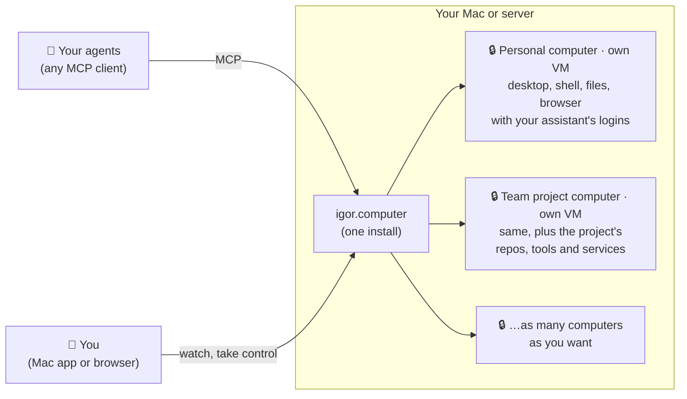

<h1 align="center">igor.computer</h1>

<p align="center">
  <b>A real computer for your AI agents, running on your own machine.</b>
</p>

<p align="center">
  <a href="#install">Install</a> ·
  <a href="#make-your-own-computer">Make your own</a> ·
  <a href="docs/architecture.md">How it works</a> ·
  <a href="#documentation">Docs</a>
</p>

---

Give your agent a Linux desktop of its own: a shell, files, apps and a browser
with real logins. It keeps everything between tasks, any MCP agent can use it,
and you can watch or take over at any time.



## Why

Agents get much more useful with a computer of their own. The usual options each miss something:

|  | Your own machine | Throwaway sandbox | Hosted agent computer | **igor.computer** |
| --- | :---: | :---: | :---: | :---: |
| Walled off from your files and accounts | ❌ | ✅ | ✅ | ✅ |
| Remembers between tasks | ✅ | ❌ | ✅ | ✅ |
| You can watch and step in | ⚠️ you can't work meanwhile | ❌ | ✅ | ✅ |
| Works with any agent | ✅ | ✅ | ❌ one vendor | ✅ |
| Logins and data stay on your hardware | ✅ | ✅ | ❌ their cloud | ✅ |

On your own machine, one bad instruction or prompt injection can reach your whole
session. Hosted computers like OpenAI Dots or Grok Bot ([comparison](docs/agent-computers.md))
keep your logins on someone else's servers. igor.computer gives you the same kind
of sandboxed agent computer, but on your own Mac or server.

## What you get

<table>
  <tr>
    <td>🖥️ <b>A full Linux computer</b></td>
    <td>Shell, persistent <code>/workspace</code>, desktop apps and any tools you install.</td>
  </tr>
  <tr>
    <td>🌐 <b>A browser with real logins</b></td>
    <td>Agents drive it and stay signed in to the sites you log in to. The base image ships Chromium, and the browser is optional.</td>
  </tr>
  <tr>
    <td>💾 <b>It remembers</b></td>
    <td>Files, tools, logins and open windows survive restarts. Idle computers sleep and wake in ~5 s exactly as they were.</td>
  </tr>
  <tr>
    <td>🙋 <b>You stay in charge</b></td>
    <td>Watch live, take control any time, type the passwords yourself. One switch pauses all automation.</td>
  </tr>
  <tr>
    <td>🗂️ <b>Many computers</b></td>
    <td>One for your assistant, one per team or project, or one per agent, each in its own VM.</td>
  </tr>
  <tr>
    <td>📄 <b>Defined in a file</b></td>
    <td>Tools, repos, services, MCP servers and mounts in a <code>devcontainer.json</code> you keep in git.</td>
  </tr>
</table>

**Try asking your agent:**

> "Clone this repo, run its tests and open the dev server in the browser."
>
> "Find this week's invoices on the supplier site and save them as PDFs."
>
> "Keep the API server running and check its logs tomorrow."

## Install

You need an Apple Silicon Mac with macOS 13 or later.

> 🚧 **Downloads are coming.** Signed releases with auto-updates are set up, but
> none is published yet. For now, [build and run from source](docs/development.md#build-and-run-from-source).

The app installs a background server. The first start builds your computer,
which takes a few minutes.

## Connect your agent

For Claude Code:

```sh
claude mcp add --env IGOR_COMPUTER_WORKSPACE=claude-code igor-computer -- "$HOME/Library/Application Support/igor.computer/server/bin/igor-computer" mcp
```

`IGOR_COMPUTER_WORKSPACE` gives the agent its own desktop, so it doesn't get in
your way. Choose **open computer** in the menu bar to watch it work.

<details>
<summary>Other MCP clients</summary>

```json
{
  "mcpServers": {
    "igor-computer": {
      "command": "/Users/YOU/Library/Application Support/igor.computer/server/bin/igor-computer",
      "args": ["mcp"],
      "env": { "IGOR_COMPUTER_WORKSPACE": "my-agent" }
    }
  }
}
```

Codex needs one more setting; see [Connect your agent](docs/agents.md).

</details>

## Make your own computer

The default computer is a clean Debian desktop with a shell, Python, Git and
Chromium. Build one with your team's tools, repos and services:

```sh
igor-computer init ~/my-computer                 # writes .igor-computer/devcontainer.json
igor-computer create my-computer ~/my-computer   # a folder or a git URL
igor-computer mcp my-computer                    # point an agent at it
```

<details>
<summary>Example <code>devcontainer.json</code></summary>

```jsonc
{
  "name": "my-computer",
  "postCreateCommand": "cd /workspace/web && npm install",
  "customizations": {
    "igor.computer": {
      "packages": ["nodejs", "npm", "ripgrep"],
      "repos": ["https://github.com/you/web", "https://github.com/you/api"],
      "mcp": { "files": { "command": "npx", "args": ["-y", "@modelcontextprotocol/server-filesystem", "/workspace"] } },
      "secrets": { "GITHUB_TOKEN": "keychain:my-github" },
      "resources": { "cpus": 4, "memory": "8GiB" }
    }
  }
}
```

</details>

Definitions also support your own Dockerfile, [dev container features](https://containers.dev/features),
host folder mounts and raw VM settings. See [Computers](docs/computers.md) and
the [team example](examples/team/.igor-computer/devcontainer.json).

## Built on open parts

igor.computer is a thin layer over existing tools, and you can swap out any part of it:

| Layer | What it does | Built on |
| --- | --- | --- |
| **Hardware** | Runs each computer as a VM, sleeps and wakes it, serves agents and viewers, decides who controls the desktop. | [Lima](https://lima-vm.io), [QEMU](https://www.qemu.org), [MCP](https://modelcontextprotocol.io) via [TanStack AI](docs/tanstack.md), [noVNC](https://novnc.com) |
| **OS** | Any container image that meets a small [OS contract](docs/computers.md#the-os-contract). The base image is Debian with a desktop, a shell, Python, Git and Chromium. | Docker / OCI, [Chrome DevTools MCP](https://github.com/ChromeDevTools/chrome-devtools-mcp), [computer-use-linux](https://github.com/agent-sh/computer-use-linux) |
| **Definition** | Your computer's packages, repos, services, MCP servers, mounts and secrets. | [devcontainer.json](https://containers.dev) |

## Status

Early, and used daily by its author.

- ✅ macOS on Apple Silicon is the tested setup.
- 🚧 Linux hosts are implemented but not yet validated on real hardware.
- 🚧 Signed releases with auto-updates are set up but none is published yet.

It started as the computer for [Igor](docs/igor.md), a personal AI assistant,
but it doesn't depend on Igor.

## Documentation

- [Computers](docs/computers.md): definitions, the OS contract, the CLI
- [How it works](docs/architecture.md): tools, human control, sleep, security
- [Running a server](docs/server.md): remote access, Linux, configuration
- [Connect your agent](docs/agents.md): Claude Code, Codex, other MCP clients
- [TanStack AI](docs/tanstack.md): computer use in your own apps
- [Development](docs/development.md): building, testing, distribution
- [Using with Igor](docs/igor.md)
- [Agent skill](skills/igor-computer/SKILL.md): instructions to give your agent
