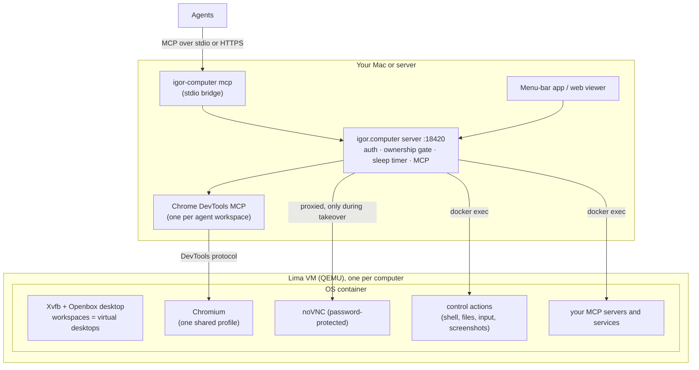

# How it works

This page explains what agents can do on a computer, how you and they share it,
how it sleeps, and where its security boundaries are. To set up computers, see
[Computers](computers.md). To run a server for other machines, see
[Running a server](server.md).

## The pieces

- The **server** runs in the background under launchd (macOS) or systemd
  (Linux), independently of the app. Quitting the app doesn't stop your computers.
- Each **computer** is a Lima VM with its own Docker daemon, running one container
  built from the computer's OS image.
- **Agents** connect over MCP, either through the stdio bridge or over
  authenticated HTTP. Both are served by [TanStack AI](tanstack.md)'s MCP server. The default computer is at `/mcp`, and named computers are
  at `/computers/NAME/mcp`.

## What agents can do

Browser work and desktop work are separate tool sets. For web tasks, agents use
the [Chrome DevTools MCP](https://github.com/ChromeDevTools/chrome-devtools-mcp)
tools directly: pages, navigation, DOM and accessibility snapshots, input and
JavaScript. Navigating a page doesn't need screenshots or mouse clicks.

| Tools | Purpose |
| --- | --- |
| Chrome DevTools tools (`list_pages`, `navigate_page`, `take_snapshot`, …) | The browser. Present when the computer has one, which is the default. |
| `computer_ui_get_app_state`, `computer_ui_list_apps` | Accessibility trees of desktop apps, from [computer-use-linux](https://github.com/agent-sh/computer-use-linux). |
| `computer_ui_perform_action`, `computer_ui_set_value`, `computer_ui_click` | Operate controls by their accessibility identity. |
| `computer_ui_screenshot`, `computer_ui_press_key`, `computer_ui_type_text`, `computer_ui_drag`, `computer_ui_scroll` | Look at the screen and use mouse and keyboard. |
| `computer_exec` | Shell commands, run as an unprivileged user. |
| `computer_file` | Read, write or list files in `/workspace`, up to 512 KiB at a time. |
| `computer_workspace` | List or select workspaces, and open or move browser windows. |
| `computer_screenshot`, `computer_input` | Screenshots (or one region, for zooming) and mouse and keyboard on the agent's own workspace: clicks with any button and count, moves, presses and releases, keys, typing, pixel scrolling and the cursor position. |
| `computer_begin_turn`, `computer_end_turn` | Keep the computer awake for a whole task. |
| `computer_sleep`, `computer_wake` | Sleep or wake the computer explicitly. |
| `browser_status` | Who controls the computer, its state, active turns and help requests. |
| `browser_request_human`, `browser_wait_human`, `browser_withdraw_human` | Ask the person for help, check on the request, or withdraw it. |
| `SERVER__TOOL` | Tools from MCP servers that the computer's definition runs inside it. |

Accessibility support depends on what each app exposes. Chromium's accessibility
is turned on. computer-use-linux's own setup and shell tools are not exposed,
because `computer_exec` is the shell.

## Workspaces

One computer can serve several agents at once. Each agent gets a **workspace**:
an Openbox virtual desktop of its own, named after its client
(`IGOR_COMPUTER_WORKSPACE`). It also gets its own DevTools connection, so each
agent has its own selected page.

All workspaces share one browser profile, so they share logins. They share the
files in `/workspace` too. Workspaces keep windows apart; they don't separate
accounts and aren't a security boundary. When agents need separate logins, give
them separate computers.

**Your desktop** is the person's own workspace. The default workspace name,
`shared`, maps to it, so give agents their own workspace name.

Some agent clients send a roster of agents with names and pictures to
`POST /workspace-sync`. The viewer then shows those names and avatars. When an
agent leaves the roster, its workspace is retired and its windows move to your
desktop, tabs and logins intact. A roster that arrives while the computer
sleeps is applied when it wakes; syncing never wakes it.

There is one screen, mouse and keyboard per computer. Browser commands from
different agents run in parallel. Actions that need the physical screen
(screenshots, mouse and keyboard, opening windows) go through a single gate, one
at a time. A busy response means "retry shortly". Browser recovery and
`new_page` open background windows on the agent's own workspace without
stealing focus.

## Human control

**Watching.** Pick a workspace in the viewer to see it live, including dialogs
and window frames. Watching doesn't pause the agent. While another workspace is
using the shared mouse and keyboard, the view keeps showing its last frame.

**Taking control.** **Take control** waits for the agent's current command, then
gives you the mouse and keyboard on that workspace. Only that workspace's agent
is paused; other agents keep doing browser, shell and file work. Physical input
from other agents waits until you're done. **Your desktop** opens straight into
control.

**Handing back.** **Done** returns control. Switching workspaces or closing the
native window also returns it. Closing a web viewer tab without **Done** keeps
control, so reopen it to finish. A network disconnect never quietly hands
control back.

**Pausing.** The **automation** switch pauses every agent on that computer, and
stays paused until you turn it back on.

**Help requests.** An agent calls `browser_request_human` with a short message.
The Mac app shows a notification, from any computer. Without the app, the agent
gets a viewer URL to pass on. A request only asks: nothing pauses, so the agent
can keep working on something else, and you can answer it however you like.

- Take control of the agent's workspace and hand it back: the request is `continued`.
- Choose **dismiss request** in the menu: the request is `dismissed`.
- Tell the agent some other way (in chat, say), and it withdraws the request itself.
- Ignore it: it expires after a day.

Each agent has at most one open request; asking again replaces it.

While an agent works, the viewer shows its avatar, a cursor hint where it clicks,
and typing indicators. The text it types, URLs, selectors and scripts are never
shown.

**Viewer extras.** A taskbar under the desktop has an apps menu. It lists the
graphical apps installed in the computer, from their standard `.desktop` files.
Chromium, the terminal and the app store are pinned to start with. Pin apps
there and reorder them by dragging. Launching, focusing or closing apps
requires control. Switching workspaces fades through the workspace's picture and
name, unless reduced motion is on.

## Sleep and persistence

After five idle minutes (configurable per computer with `idleSleep`), the server
saves the VM's memory and disk with QEMU and stops it. A computer never sleeps
during a turn, a running command or while you're in control. Checking status doesn't wake it; the next tool call does. On a Mac,
sleeping takes about 3 seconds and waking about 5.

Waking restores the saved memory before the VM runs anything, so open pages,
unsaved form text and running programs come back. DevTools page IDs change after
a wake, so agents call `list_pages` again. Websites may have dropped connections
or expired sessions in the meantime.

What survives what:

| | Sleep / restart | Rebuild (`igor-computer rebuild`) | Delete (`igor-computer rm`) |
| --- | --- | --- | --- |
| Browser logins (`/profile`) | kept | kept | gone |
| Home folder, user-installed tools (`/home/browser`) | kept | kept | gone |
| Files (`/workspace`) | kept | kept | gone |
| Open windows and memory | kept | gone | gone |
| System packages installed by hand | kept | gone (put them in the definition) | gone |

The saved memory is tied to the exact QEMU version. If QEMU changes while a
computer sleeps, it refuses to restore instead of losing state; wake the
computer before upgrading QEMU. Saved memory only works on the same machine.

A turn (`computer_begin_turn` … `computer_end_turn`) keeps the computer awake
for a whole task, including the gaps between tool calls. Turns survive server
restarts and never expire on their own, so an agent that crashes mid-turn leaves
the computer awake until someone ends its turn. After a server restart, an
interrupted takeover comes back paused, so automation never resumes by itself.
Open help requests survive restarts.

## Security

- The server listens on `127.0.0.1:18420` and requires a token, stored in the
  state folder, for every request except the viewer page itself. It also checks
  the `Host` and `Origin` headers, against DNS rebinding and cross-site requests.
- Credentials belong in private client config, never in prompts or tool arguments.
- The VM has no access to your files or SSH agent unless a definition adds bind
  mounts. Chromium is stock and sandboxed. The container runs unprivileged, with
  all Linux capabilities dropped and a seccomp profile.
- So that Flatpak can sandbox apps, the container runs without Docker's AppArmor
  profile and `/proc` masks, and its seccomp profile allows mounts. The kernel
  permits those mounts only inside a process's own user namespace. The VM, not
  the container, is the isolation boundary.
- The desktop stream inside the VM is password-protected with a random
  credential. Web pages in the computer's own browser therefore can't take over
  the desktop through localhost.
- The raw DevTools and display ports, the Docker socket and the QEMU monitor
  listen on host loopback without authentication. They are trusted-host
  internals: any program running as your user can reach them and bypass the
  ownership gate. Never expose them; publish only the server port, as described
  in [Running a server](server.md).
- Agents don't get CAPTCHA bypasses, and they never touch your personal browser.
  The person types secrets and solves challenges.

Not yet validated: Linux/KVM hosts, production TLS deployments,
password-manager desktop integration, Touch ID, passkeys and per-site CAPTCHA
behavior.
